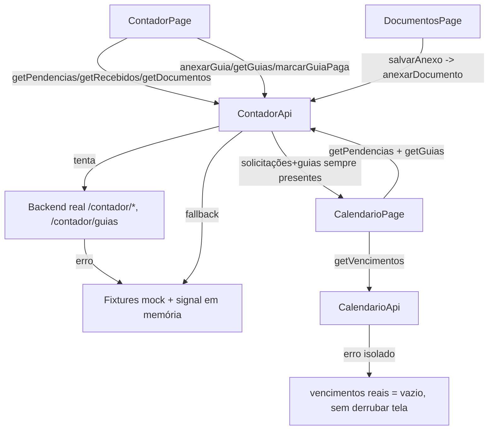

# Fluxo de Documentos e Obrigações do Contador — Design

**Spec**: `.specs/features/contador-fluxo-documentos/spec.md`
**Context**: `.specs/features/contador-fluxo-documentos/context.md`
**Status**: Approved

---

## Architecture Overview

Sem novo componente de UI (o layout de 6 abas do Contador é mantido). O trabalho é quase todo em
`ContadorApi` (novo domínio "guia" + fixtures de fallback) e em três páginas já existentes que passam a
consumir esse fallback. `CalendarioApi` não muda (continua zero-mock, per AD-008) — o que muda é como
`calendario.ts` **combina** as duas fontes.



---

## Approach Exploration

Três abordagens possíveis para o fallback mock do `ContadorApi`:

1. **Fixtures estáticas puras (sem estado)** — cada chamada com erro retorna sempre o mesmo array
   constante. Simples, mas "Anexar guia"/"marcar paga" não teriam efeito visível (a UI não refletiria a
   ação do usuário).
2. **Signal em memória seedado com fixtures + mutação local (recomendado)** — um `signal` privado no
   `ContadorApi`, inicializado lazy com fixtures na primeira falha, e mutado localmente por
   criar/editar/marcar-paga. Mesma ideia do cache local já usado em `DashboardApi.dashboard` — reaproveita
   um padrão existente no projeto, e cumpre a espectativa da spec (P1: "produtor marca como paga… reflete
   em ambas as telas").
3. **Estado global em `localStorage`** — sobrevive a F5. Descartado no discuss (usuário não pediu, e
   nenhum outro service do projeto usa `localStorage` — quebraria a convenção atual).

**Escolhida: opção 2.** Consistente com o padrão já em uso (`DashboardApi`), sem introduzir mecanismo novo
de persistência no browser, e suficiente para o loop de demo pedido pelo usuário (dados sobrevivem
enquanto o app não recarrega — F5 é aceitável perder, já que o objetivo é a rota real do backend#74).

---

## Code Reuse Analysis

### Existing Components to Leverage

| Component | Location | How to Use |
| --- | --- | --- |
| `ContadorApi.getPendencias/getRecebidos/getDocumentos` | `services/contador/data-access/contador.service.ts` | Trocar `catchError(() => of([]))` por fallback com fixtures (mesma assinatura, mesmo Observable) |
| `DashboardApi.dashboardSignal` pattern | `services/dashboard/data-access/dashboard.service.ts:11-13` | Replicar para um `guiasSignal` privado + `guias` readonly no `ContadorApi` |
| `VencimentoFiscal` model | `core/models/vencimento-fiscal.model.ts` | Usado como-está para representar a guia no calendário (`tipo:'imposto'`, `status`, `valor`) — sem alteração de schema |
| `calendario.ts: mapPendenciasParaEventos()` | `pages/calendario/calendario.ts:142-157` | Padrão de mapeamento reaproveitado para um novo `mapGuiasParaEventos()` |
| `novaSolicitacaoForm` (Reactive Forms + Validators) | `pages/contador/contador.ts:86-94` | Mesmo padrão (`FormBuilder`, `Validators.required`) para o novo form de guia |
| Dialog markup pattern (overlay + `(click)="fecharX()"` + `stopPropagation`) | `pages/contador/contador.html:316-388` | Reaproveitado 1:1 para o novo dialog "Anexar guia" |
| `ToastService` | `core/services/toast.service.ts` | Usado para o toast "em breve" (WhatsApp) e para sucesso/erro de guia |
| Banner "dados de exemplo" | `pages/contador/contador.html:3-5` | Já existe e permanece estático (sempre visível) — nenhuma mudança necessária |

### Integration Points

| System | Integration Method |
| --- | --- |
| Backend real `/contador/guias` (ainda não existe — backend#74) | `ContadorApi` tenta a chamada HTTP real primeiro; `catchError` cai para o signal mock |
| `calendario.ts` | Troca `forkJoin({ vencimentos, pendencias })` por leitura desacoplada (cada fonte com seu próprio `catchError`, combinadas com `combineLatest` ou duas subscriptions independentes que atualizam o mesmo array via merge incremental) |
| `documentos.ts` | `salvarAnexo()` passa a chamar `contadorService.anexarDocumento(id, file, categoria)` de verdade |

---

## Components

### `ContadorApi` (extensão)

- **Purpose**: Adicionar fallback com fixtures nas 3 leituras existentes + CRUD mock de guias fiscais.
- **Location**: `src/app/services/contador/data-access/contador.service.ts`
- **Interfaces** (novas/alteradas):
  - `getPendencias(produtorId?): Observable<SolicitacaoContador[]>` — fallback muda de `of([])` para `of(FIXTURE_PENDENCIAS)`
  - `getRecebidos(produtorId?): Observable<SolicitacaoContador[]>` — idem, `FIXTURE_RECEBIDOS`
  - `getDocumentos(pendenciaId): Observable<DocumentoContador[]>` — idem, `FIXTURE_DOCUMENTOS` (filtrado por `pendenciaId` quando possível, senão array genérico)
  - `getGuias(produtorId?): Observable<GuiaFiscal[]>` — tenta `GET /contador/guias`, fallback no signal mock (seed lazy com `FIXTURE_GUIAS` na primeira leitura)
  - `anexarGuia(dto: CreateGuiaDto): Observable<GuiaFiscal | null>` — tenta `POST /contador/guias`, fallback: cria localmente no signal com `status` calculado (`vencido` se `dataVencimento` < hoje, senão `pendente`)
  - `marcarGuiaPaga(id: string): Observable<void>` — tenta `PATCH /contador/guias/:id/pagar`, fallback: atualiza o item no signal para `status: 'pago'`
- **Dependencies**: `ApiService` (existente)
- **Reuses**: Padrão de cache-signal do `DashboardApi`

### `GuiaFiscal` (novo model)

- **Purpose**: Representar uma guia fiscal registrada pelo contador.
- **Location**: `src/app/core/models/solicitacao-contador.model.ts` (mesmo arquivo de `SolicitacaoContador`/`DocumentoContador` — mesmo domínio "contador")
- **Interfaces**: ver Data Models abaixo.
- **Dependencies**: nenhuma
- **Reuses**: convenção de status union-string já usada em `SolicitacaoContador`

### `calendario.ts` (ajuste no merge)

- **Purpose**: Desacoplar a leitura de `CalendarioApi.getVencimentos()` da leitura de `ContadorApi` (pendências + guias), para que uma falha isolada em `/calendario-fiscal` não esconda dados mock do Contador.
- **Location**: `src/app/pages/calendario/calendario.ts`
- **Interfaces** (alteradas):
  - `carregar()` — troca `forkJoin({vencimentos, pendencias})` por chamadas independentes (cada uma com seu próprio `subscribe`/`catchError`), unindo o resultado incrementalmente no signal `vencimentos`
  - novo `mapGuiasParaEventos(guias: GuiaFiscal[]): VencimentoFiscal[]` (espelha `mapPendenciasParaEventos`)
- **Dependencies**: `CalendarioApi`, `ContadorApi` (já injetado)
- **Reuses**: `mapPendenciasParaEventos()` como template para `mapGuiasParaEventos()`

### `ContadorPage` (extensão)

- **Purpose**: Ação "Anexar guia" (form + dialog), exibir guias na aba "Docs Oficiais", checklist de fechamento na mesma aba, ação "marcar paga", badge WhatsApp "em breve".
- **Location**: `src/app/pages/contador/contador.ts` + `.html`
- **Interfaces** (novos métodos no componente):
  - `abrirAnexarGuia()/fecharAnexarGuia()`
  - `salvarGuia()` — chama `contadorService.anexarGuia()`, mostra toast "em breve" (WhatsApp) + toast de sucesso
  - `marcarPaga(guiaId: string)`
  - `readonly checklistItens = computed(...)` — deriva do período selecionado + guias/documentos mock
  - `toggleChecklistItem(item)` — marca localmente (signal `checklistState`) como recebido/pendente
  - novas categorias adicionadas ao array `categorias`
- **Dependencies**: `ContadorApi`, `ToastService`, `FormBuilder` (já injetados)
- **Reuses**: `novaSolicitacaoForm` como template de form reativo; dialog markup pattern

### `DocumentosPage` (ajuste pontual)

- **Purpose**: Ligar `salvarAnexo()` de verdade ao `ContadorApi.anexarDocumento()`.
- **Location**: `src/app/pages/documentos/documentos.ts`
- **Interfaces** (alterado):
  - `salvarAnexo()` — chama `this.contadorService.anexarDocumento(this.solicitacaoSelecionada(), file, categoria)`, trata sucesso/erro, atualiza `solicitacoes` local (status → `enviado`)
- **Dependencies**: já injeta `ContadorApi`
- **Reuses**: padrão de `subscribe({next, error})` já usado no resto do componente

---

## Data Models

### `GuiaFiscal` (novo — em `solicitacao-contador.model.ts`)

```typescript
export type TipoGuia = 'ICMS' | 'FUNRURAL' | 'DARF' | 'GPS' | 'OUTRO';

export interface GuiaFiscal {
  id: string;
  produtorId: string;
  tipoGuia: TipoGuia;
  dataVencimento: string; // YYYY-MM-DD
  valor: number;
  status: 'pendente' | 'pago' | 'vencido';
  observacoes?: string;
  createdAt: string;
}

export interface CreateGuiaDto {
  produtorId: string;
  tipoGuia: TipoGuia;
  dataVencimento: string;
  valor: number;
  observacoes?: string;
}
```

**Relationships**: Convertida para `VencimentoFiscal` (`tipo: 'imposto'`) no `calendario.ts`, análogo ao
que já acontece com `SolicitacaoContador` → `VencimentoFiscal` (`tipo: 'solicitacao'`). Não referencia
`DocumentoContador` (guia é metadado, sem arquivo — ver Out of Scope da spec).

### `ChecklistItem` (novo, local à página — não é model de domínio persistido)

```typescript
interface ChecklistItem {
  categoria: string; // 'Balancete' | 'Balanço' | 'Extrato bancário' | 'Guia de imposto' | 'Documento para IR'
  recebido: boolean;
}
```

Estado mantido em signal na própria `ContadorPage` (`checklistState = signal<Record<string, boolean>>({})`,
chave = `${periodo}:${categoria}`), sem necessidade de model de domínio — é puramente local/mock (spec
CTD-20/21, sem endpoint proposto por não haver menção a persistência real na issue original).

---

## Error Handling Strategy

| Error Scenario | Handling | User Impact |
| --- | --- | --- |
| `GET /contador/pendencias` \| `/recebidos` \| `/documentos` falha | `catchError` retorna fixture correspondente | Painel aparece populado; banner "dados de exemplo" já visível no topo |
| `GET/POST/PATCH /contador/guias` falha | `catchError` cai no signal mock (leitura/criação/atualização local) | Ação do usuário (anexar/marcar paga) sempre reflete na tela, mesmo sem backend |
| `GET /calendario-fiscal/:id/vencimentos` falha | Erro tratado isoladamente; `vencimentos` reais viram `[]`, mas guias/solicitações do `ContadorApi` continuam sendo mescladas | Calendário mostra pelo menos as guias/solicitações mock, nunca a tela de erro cheia que existia antes |
| `POST /contador/documentos/anexar` falha (via `salvarAnexo`) | `catchError` no service retorna um `DocumentoContador` mock local (mesma forma de fallback das leituras) para não quebrar o loop de demo | Toast de sucesso, solicitação muda para "enviado" mesmo sem backend |
| Valor da guia ≤ 0 no form | Validação client-side (`Validators.min(0.01)`) bloqueia o submit antes de chamar o service | Botão "Salvar" desabilitado, sem chamada de rede |

---

## Risks & Concerns

| Concern | Location (file:line) | Impact | Mitigation |
| --- | --- | --- | --- |
| `calendario.ts` usa `forkJoin` hoje — trocar para leitura desacoplada muda o timing dos testes existentes (`calendario.spec.ts` depende de `flushPendencias()` resolvendo antes do erro do `forkJoin` cancelar a outra branch) | `pages/calendario/calendario.ts:116-135`, `pages/calendario/calendario.spec.ts:19-37` | Testes existentes (AC-9) podem quebrar com a mudança de estratégia de combinação | Task dedicada para migrar os 3 testes existentes junto com a mudança do merge, mantendo as mesmas asserções de comportamento (não regressão) |
| `ContadorApi` ainda não tem nenhum spec de teste (`contador.service.spec.ts` não existe) | `services/contador/data-access/` | Risco de introduzir fixtures sem cobertura formal | Task dedicada cria `contador.service.spec.ts` cobrindo fallback de todas as leituras + CRUD de guia (padrão do `calendario.service.spec.ts`) |
| Fixture de guia "vencida" depende de `new Date()` no momento do teste/execução | `contador.service.ts` (novo código) | Teste pode ficar não-determinístico se comparar contra data fixa | Calcular `status` a partir de comparação relativa (`dataVencimento < hoje`), e no teste injetar datas relativas (`hoje - 1 dia` / `hoje + 30 dias`) em vez de datas absolutas fixas |

> Nenhum outro risco relevante identificado nas áreas tocadas.

---

## Tech Decisions (only non-obvious ones)

| Decision | Choice | Rationale |
| --- | --- | --- |
| Onde colocar `GuiaFiscal` | Mesmo arquivo `solicitacao-contador.model.ts` (não um arquivo novo) | Já é o arquivo "domínio contador"; segue a convenção de "1 arquivo por domínio" do CLAUDE.md — guia é parte do domínio contador, não um domínio próprio |
| `calendario.ts`: como desacoplar sem `forkJoin` | Duas assinaturas independentes que atualizam o mesmo array via merge incremental (`vencimentosReais` + `vencimentosContador`, combinados num `computed()`) | Mais simples que `combineLatest` com estado de erro por fonte; evita re-introduzir uma dependência de timing como o `forkJoin` atual |
| Checklist não vira endpoint novo | Estado 100% local (signal na página) | Issue não pede persistência do checklist entre sessões; simplicidade > escopo não pedido |

> Isso não introduz nenhuma nova convenção de projeto (AD-NNN) — é local à feature. A única decisão que
> vira convenção é a já registrada no `context.md`: guia tenta API real e cai para mock em memória, igual
> ao padrão pré-existente do `ContadorApi`.
