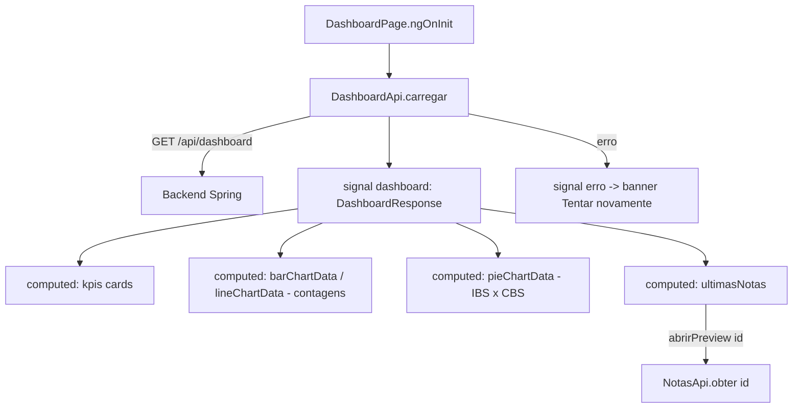

# Dashboard API Real — Design

**Spec**: `.specs/features/dashboard-api-real/spec.md`
**Status**: Draft

Conforma às decisões ativas AD-001…AD-006 (`.specs/STATE.md`).

---

## Architecture Overview

Uma única chamada consolidada substitui as cinco atuais. O `DashboardApi` ganha `carregar(periodo?)`
que faz `GET /api/dashboard`, cacheia o `DashboardResponse` num signal singleton (root) e expõe leitura.
A `DashboardPage` orquestra loading/erro/vazio e deriva os view-models dos cards via `computed()`.
O preview de nota busca a nota completa sob demanda em `NotasApi`.



---

## Code Reuse Analysis

### Existing Components to Leverage

| Component | Location | How to Use |
| --- | --- | --- |
| `ApiService.get` | `core/services/api.service.ts` | Fazer `GET /api/dashboard` (interceptor prefixa `/api`). |
| `NotasApi.obter(id)` | `services/notas/data-access/notas.service.ts` | Carregar nota completa no preview (AD-003). |
| `statusNotaLabel` / `statusNotaBadge` | `core/enums/status-nota-fiscal.enum.ts` | Badges de status em `ultimasNotas`. |
| `NotaPreview` | `shared/components/nota-preview/` | Render do preview no modal (já usado). |
| `BaseChartDirective` + registro enxuto de Chart.js | `pages/dashboard/dashboard.ts` | Manter registro por componente (chunk lazy) — CLAUDE.md. |
| Tokens de design (HSL) | `styles.css` `@theme` | Cores dos gráficos/cards (não hardcodar). |
| `LOGGED_PRODUCER_ID` | `core/config/produtor-logado.ts` | Não é mais necessário no dashboard (produtor vem do payload); manter só onde ainda usado. |

### Integration Points

| System | Integration Method |
| --- | --- |
| `GET /api/dashboard` | Novo DTO `DashboardResponse`; sem `periodo` no MVP. |
| `GET /api/notas/{id}` | `NotasApi.obter` no preview. |

---

## Components

### `DashboardApi` (refatorado)

- **Purpose**: Cliente do agregador de dashboard + cache Signals; remove mocks e métodos obsoletos.
- **Location**: `src/app/services/dashboard/data-access/dashboard.service.ts`
- **Interfaces**:
  - `carregar(periodo?: string): Observable<DashboardResponse>` — `GET /api/dashboard`; em sucesso
    atualiza o signal de cache (`tap`). **Não** faz `catchError` (a página trata o erro para o retry).
  - `readonly dashboard: Signal<DashboardResponse | null>` — último resultado cacheado (singleton root).
- **Remove**: `getFluxoCaixa`, `getProdutor`, `getProdutores`, `getNotasPorMes`, `getDistribuicaoImpostos`,
  `getImpostosPorTipo`, `mockNotas`, `mockNotasPorMes`, `MOCK_DISTRIBUICAO`, `AMOSTRA_MENSAL`,
  `ResumoMensalNotas`, `DistribuicaoImposto` (tipos migram para o DTO). Métodos de rascunho permanecem
  (fora de escopo desta issue).
- **Dependencies**: `ApiService`.
- **Reuses**: `ApiService`, padrão de service de negócio (classe `XxxApi`).

### `DashboardPage` (refatorada)

- **Purpose**: Orquestra a carga única e deriva os cards; estados loading/erro/vazio.
- **Location**: `src/app/pages/dashboard/dashboard.ts` + `.html`
- **Interfaces (novos/alterados)**:
  - `carregarDashboard(): void` — chama `DashboardApi.carregar()`, seta `loading`/`erro`.
  - `tentarNovamente(): void` — re-chama `carregarDashboard()`.
  - `readonly dashboard`, `loading`, `erro` — signals de estado.
  - `readonly kpisCards = computed(...)` — deriva de `dashboard().kpis`.
  - `barChartData`/`lineChartData` — `computed` sobre `notasPorMes` (contagens); rótulo mês de `periodo`.
  - `pieChartData` — `computed` sobre `distribuicaoImpostos` (`ibs`,`cbs`).
  - `ultimasNotas = computed(...)` — de `dashboard().ultimasNotas`.
  - `abrirPreview(nota)` — `NotasApi.obter(id)` → `notaDetalhada`.
- **Remove**: `fluxoCaixa`, `nomeUsuario` mock default (passa a vir do payload), `impostoBreakdown`
  somando notas (rederiva de `kpis`), consumo de `getFluxoCaixa/getProdutor/getNotasPorMes/...`.
- **Dependencies**: `DashboardApi`, `NotasApi`, `ToastService`, ícones Lucide, Chart.js.
- **Reuses**: registro de Chart.js, `NotaPreview`, enums de status.

### `documentos.ts` (ajuste pontual — DASH-11)

- **Purpose**: Remover fallback `mockNotas()`; usar estado de erro + retry.
- **Location**: `src/app/pages/documentos/documentos.ts`
- **Change**: no `error` de `recarregarNotas`, setar `notas([])`, `totalElements(0)`, `notasErro(true)`,
  sem `mockNotas()`. Remover import de `mockNotas`.

### DTO `DashboardResponse` (novo)

- **Location**: `src/app/core/DTOs/dashboard/dashboard.response.ts` (alias `@dtos/dashboard/...`).

---

## Data Models

```typescript
// core/DTOs/dashboard/dashboard.response.ts
import { StatusNotaFiscal } from '@core/enums/status-nota-fiscal.enum';

export type OrigemNota = 'PROPRIA' | 'IMPORTADA';

export interface DashboardProdutorResumo {
  nome: string;
  tipoProdutor: string;
  uf: string;
}

export interface DashboardKpis {
  debitoIbs: number;
  debitoCbs: number;
  creditoIbs: number;
  creditoCbs: number;
  saldoIbs: number;
  saldoCbs: number;
  totalNotas: number;
}

export interface DashboardNotasPorMes {
  periodo: string;   // "YYYY-MM"
  entradas: number;  // contagem
  saidas: number;    // contagem
}

export interface DashboardDistribuicaoImpostos {
  ibs: number;
  cbs: number;
}

export interface DashboardUltimaNota {
  id: string;
  numero: number;
  origem: OrigemNota;
  contraparte: string;
  dataEmissao: string;        // ISO-8601
  valorTotalNota: number;
  status: StatusNotaFiscal;
}

export interface DashboardResponse {
  produtor: DashboardProdutorResumo;
  periodo: string;            // "YYYY-MM"
  kpis: DashboardKpis;
  notasPorMes: DashboardNotasPorMes[];
  distribuicaoImpostos: DashboardDistribuicaoImpostos;
  ultimasNotas: DashboardUltimaNota[];
}
```

**Relationships**: `status` reusa `StatusNotaFiscal`; `DashboardUltimaNota.id` referencia `NotaFiscal.id`
usado no preview via `NotasApi.obter`.

---

## Error Handling Strategy

| Error Scenario | Handling | User Impact |
| --- | --- | --- |
| `GET /api/dashboard` falha | `erro.set(true)`, `loading.set(false)`; banner com "Tentar novamente" | Vê erro honesto + botão; nenhum dado falso |
| Retry clicado | Re-chama `carregar()` | Skeletons voltam; recarrega |
| Seção vazia (arrays vazios / kpis zero) | Estado vazio neutro por card | "Sem dados no período" / `R$ 0,00` |
| `NotasApi.obter(id)` falha no preview | Toast de erro; modal mostra fallback sem quebrar | Aviso de erro, modal utilizável |
| `status` desconhecido em `ultimasNotas` | `statusNotaLabel` cai no default `—` | Badge neutro |

---

## Risks & Concerns

| Concern | Location | Impact | Mitigation |
| --- | --- | --- | --- |
| `mockNotas` é dependência cruzada de `documentos.ts` | `pages/documentos/documentos.ts:358` | Remover o mock quebra o fallback offline de Documentos | DASH-11: migrar Documentos para erro+retry no mesmo PR |
| Simulador somava IBS/CBS de 100 notas via `NotasApi.listar` | `pages/dashboard/dashboard.ts:251-267` | `ultimasNotas` não traz IBS/CBS por nota → soma quebra | Rederivar breakdown de `kpis.debitoIbs/debitoCbs` (ou `distribuicaoImpostos`) |
| "Loading por seção" com endpoint único | — | Granularidade real é por request, não por seção | Skeletons por card ligados a um único `loading`; documentado como aceito no spec |
| Legenda/textos citam FUNRURAL/ICMS/IPI | `dashboard.html:97-100,191` | Texto desatualizado vs. contrato IBS/CBS | Atualizar legenda "CBS × IBS" e narrativa educativa |
| Chart.js deve ficar no chunk lazy | `dashboard.ts:37` | Regressão de bundle inicial se mover registro | Manter `Chart.register` no componente (CLAUDE.md) |

---

## Tech Decisions (only non-obvious ones)

| Decision | Choice | Rationale |
| --- | --- | --- |
| Onde mora o cache | Signal em `DashboardApi` (root singleton) | "Cache local com Signals" sobrevive à re-navegação |
| `carregar` não faz `catchError` | Erro propaga à página | Página precisa distinguir erro para o estado de retry (AD-005) |
| Rótulo de mês | Derivar de `periodo` `YYYY-MM` | Fonte de verdade do backend, sem recalcular datas locais |
| Breakdown do simulador | De `kpis`, não de notas | `ultimasNotas` não traz IBS/CBS por nota (AD-003) |

> Sem novas decisões de nível de projeto além das AD-001…AD-006 já registradas em STATE.md.
